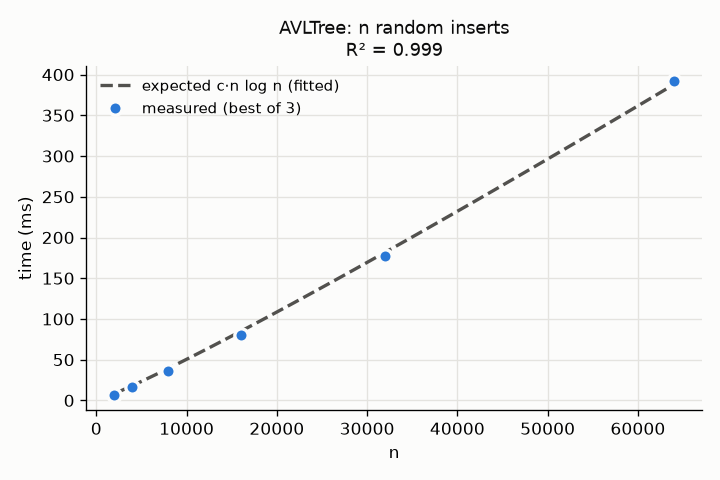
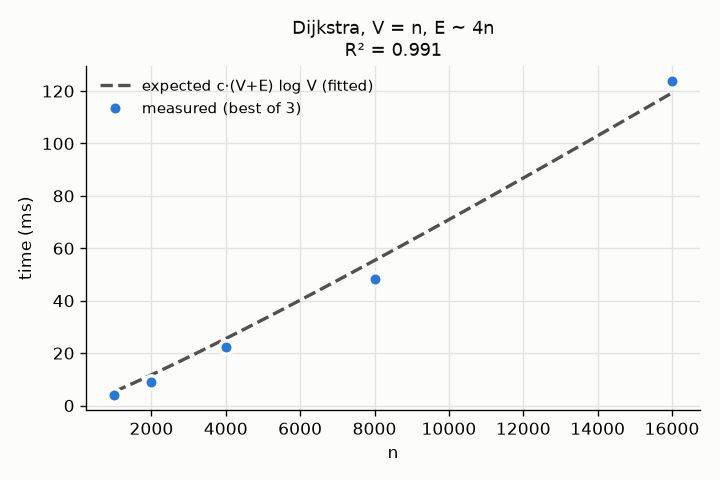
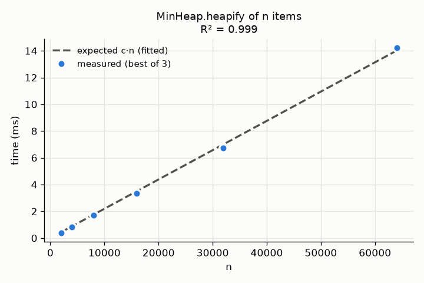
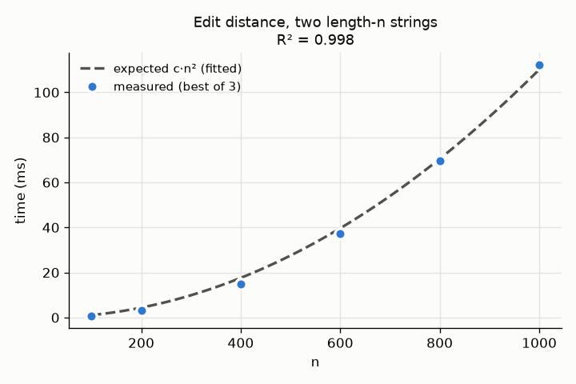

# dsa-library


Core data structures and algorithms written from first principles in Python, with a
Java port of the central pieces. The Python package covers a binary heap, a hash map,
an AVL tree, union-find, a trie, an LRU cache, graph algorithms (BFS, DFS, Dijkstra,
Kruskal's MST, Kahn's topological sort, Tarjan's SCC, Edmonds-Karp max flow) and six
dynamic-programming problems. Every module has unit tests, the main structures have
property-based tests against a trusted model, and each operation's Big-O is documented
in [complexity.md](complexity.md) and checked against measured runtimes in
[benchmarks/](benchmarks/).

## Architecture

```mermaid
graph TD
    heap[heap.py<br/>MinHeap] --> graph[graph.py<br/>Graph: BFS, DFS,<br/>Dijkstra, Kruskal]
    uf[union_find.py<br/>UnionFind] --> graph
    heap --> dgraph[directed_graph.py<br/>DirectedGraph: Kahn,<br/>Tarjan, Edmonds-Karp]
    hmap[hash_map.py<br/>HashMap] --> lru[lru_cache.py<br/>LRUCache]
    avl[avl_tree.py<br/>AVLTree]
    trie[trie.py<br/>Trie]
    dp[dp.py<br/>DP algorithms]
    java[java/ port<br/>MinHeap, HashMap, Graph] -.mirrors.-> heap
    java -.mirrors.-> hmap
    java -.mirrors.-> graph
```

| Module | What it contains |
|---|---|
| `dsa/heap.py` | `MinHeap`: list-backed binary heap; push, pop, peek, O(n) `heapify` |
| `dsa/hash_map.py` | `HashMap`: separate chaining on plain lists, doubles past load 0.75 |
| `dsa/avl_tree.py` | `AVLTree`: LL/LR/RR/RL rotations, successor-based delete |
| `dsa/union_find.py` | `UnionFind`: path compression and union by rank |
| `dsa/graph.py` | `Graph` (undirected, weighted): BFS, DFS, Dijkstra, shortest path, Kruskal MST |
| `dsa/directed_graph.py` | `DirectedGraph`: topological sort, strongly connected components, max flow |
| `dsa/trie.py` | `Trie`: insert, search, prefix queries |
| `dsa/lru_cache.py` | `LRUCache`: O(1) get/put with `HashMap` and a doubly linked list |
| `dsa/dp.py` | Fibonacci, coin change, 0/1 knapsack, LCS, edit distance, LIS |
| `java/` | Maven project: generic `MinHeap`, `HashMap`, `Graph` (BFS, Dijkstra) with JUnit 5 |

## How to run

Python (3.11+):

```bash
git clone https://github.com/ryansomers/dsa-library.git && cd dsa-library
uv venv .venv && uv pip install -e ".[dev]"
.venv/bin/ruff check .
.venv/bin/mypy dsa
.venv/bin/pytest
```

Benchmarks (regenerates `benchmarks/plots/*.png` and `benchmarks/results.md`, about 10 s):

```bash
uv pip install -e ".[bench]"
.venv/bin/python benchmarks/bench.py
```

Java (JDK 21+ and Maven):

```bash
cd java && mvn -q test
```

Quick use:

```python
from dsa.graph import Graph

g = Graph()
g.add_edge("A", "B", 1); g.add_edge("B", "C", 2); g.add_edge("A", "C", 5)
g.shortest_path("A", "C")          # ['A', 'B', 'C']
g.minimum_spanning_tree()          # (3.0, [(1, 'A', 'B'), (2, 'B', 'C')])
```

## Design decisions

- **No shortcuts in the library.** No `heapq`, no `bisect`, no third-party packages.
  `HashMap` uses only lists internally (no `dict` or `set`), and the LRU cache is built
  on that `HashMap`. Graph classes do use `dict` for adjacency lists, since the point
  there is the algorithms, not the map.
- **Comparisons use `<` only** in the heap and AVL tree, so tuples like
  `(distance, vertex)` work as heap entries without a custom comparator.
- **Dijkstra uses lazy deletion.** The heap has no decrease-key, so an improved
  distance is pushed as a new entry and stale entries are skipped when popped. This
  keeps the heap simple and costs O(E) extra heap entries at most.
- **Deterministic output.** BFS/DFS visit neighbors in sorted order, Kahn's algorithm
  breaks ties with a min-heap and SCCs are returned sorted, so tests can assert exact
  orders.
- **Iterative where depth is unbounded.** DFS, Tarjan's SCC and AVL in-order traversal
  use explicit stacks, so large inputs cannot hit Python's recursion limit. AVL insert
  and delete stay recursive because their depth is O(log n).
- **AVL height counts levels** (empty = 0, leaf = 1), so a balanced 3-node tree has
  height 2.
- **Tests compare against models.** Hypothesis property tests check the AVL tree
  against `sorted(set(...))`, the heap against `sorted`, `HashMap` against `dict`,
  Dijkstra against a brute-force Bellman-Ford, Kruskal against a simple Prim, and the
  O(n log n) LIS against the O(n²) DP.

## Results

- Python: 62 pytest tests (54 unit, 8 Hypothesis property tests) pass; `mypy --strict`
  clean on `dsa/`; `ruff check .` clean.
- Java: 18 JUnit 5 tests pass with `mvn test`.
- Benchmarks: a single fitted constant times the expected Big-O curve explains the
  measured runtimes with R² of 0.96 to 1.00 across ten operations (full table in
  [benchmarks/results.md](benchmarks/results.md)). Example plots:

| | |
|---|---|
|  |  |
|  |  |

## Limitations

- Pure Python is 10-100x slower than the built-ins (`dict`, `heapq`); this is a
  learning and reference library, not a replacement.
- `HashMap` never shrinks after removals, and the hash map benchmark grows slightly
  faster than linear at the largest sizes (R² 0.96), most likely from CPU cache
  misses as the bucket array outgrows cache.
- `Graph` rejects negative weights (Dijkstra's precondition); there is no
  Bellman-Ford in the library itself, only in the tests.
- The Java port covers `MinHeap`, `HashMap` and `Graph` (BFS, Dijkstra) only.
- Benchmark timings come from one machine and are noisy at small n.

## Notes

The hardest part was AVL delete. Insert needs at most one rotation, but a delete can
unbalance every ancestor on the way back up, and the two-child case (copy in the
in-order successor, then delete it from the right subtree) has to rebalance every node
on the path down to the successor. Checking it needed more than hand-picked cases, so a Hypothesis test mixes random
inserts and deletes and verifies the cached heights and balance at every node. Getting Tarjan's SCC iterative was the other fiddly piece,
since the low-link update that recursion does "on return" has to be done by hand when a
frame is popped.
